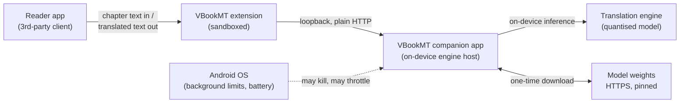
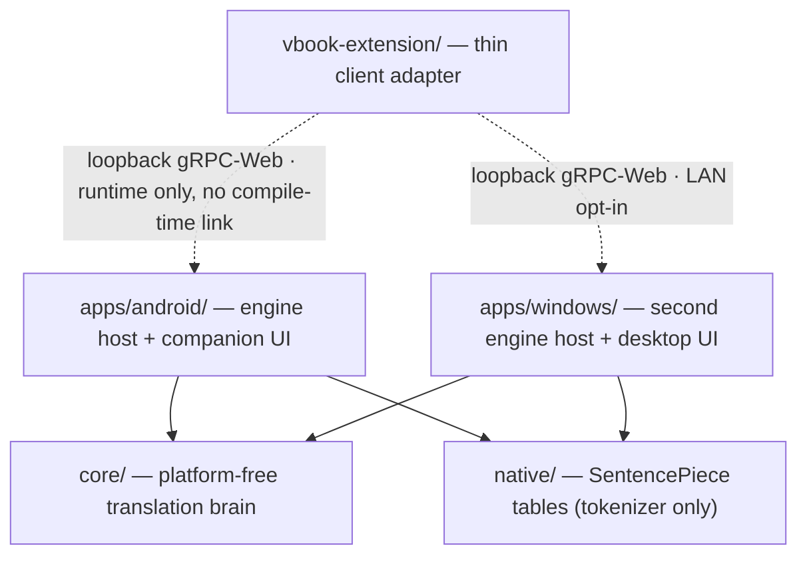

# ARCHITECTURE — VBookMT

> **One-liner:** A Chinese → Vietnamese novel translator that runs entirely on the reader's phone —
> the companion app hosts the translation engine locally, and the vBook extension feeds it chapter
> text and shows the result.

---

## 1. Context, Scope & Non-Goals

**Core goal.** Translate serialised Chinese novels into Vietnamese with production-quality output, on
device, with no network, no accounts, no API keys and no per-chapter cost — while the reader is
reading, so latency matters as much as fidelity.

**Explicit non-goals.** These are boundaries, not a backlog:

- **Not a general translation service.** One language pair, one direction, one genre register
  ("convert" style Chinese web novels). Nothing here generalises to arbitrary MT.
- **No remote access, no auth, no TLS.** The engine is a loopback resource. Any process or page on
  the device may use it, reconfigure it, or read its health. Accepted: the only asset behind the
  boundary is CPU time.
- **No streaming, no partial rendering.** A chapter is delivered whole, or the caller gets a failure
  it can explain to the reader. Nothing is rendered mid-translation.
- **No sentence-level translation units.** Sentences are too short to carry pronoun and context
  information; splitting below paragraph scale measurably degrades output.
- **No glossary, no term overrides, no translation history, no export, no multi-user, no quotas.**
- **No durable translation *store*.** A journal of finished chunks exists, but it is a cache and not a database: no schema, no migration, no query, no sharing, and discarding it is always safe. Nothing may come to depend on it beyond replay.
- **No *measured* GPU/NPU acceleration.** One engine now ships — ONNX Runtime on CPU — which is what
  the GPU/NPU story depends on. Android requests
  Qualcomm QNN (the HTP/NPU backend); a device that cannot provide it falls back to CPU and the reason
  is surfaced in `/health` rather than hidden. Desktop requests CPU on purpose — the stock
  `onnxruntime` jar carries no GPU provider and its JNI shim is CPU-only (its own binary reports
  "not compiled with DirectML support"), so DirectML or WinML would need a C++/.NET bridge that is not
  in this build. What remains unproven is the whole point of the ONNX path: **no GPU/NPU acceleration
  has been measured on real hardware**, so the engine ships as usable-but-unbenchmarked rather than as
  a claimed speed-up. A CPU comparison does not decide it either way.
- **Two supported host runtimes, one `core`.** Android and Windows both serve; both compile the same
  `native/` sources against the same dependency pins, so a translation cannot depend on which host
  answered. A third host is not a goal.
- **One engine, one tokenizer contract.** ONNX Runtime is the only engine; CTranslate2 was removed
  from both hosts, and `native/` now serves the SentencePiece tables alone. Every model consumes
  byte-identical ids from those tables, so model choice cannot change how text is split. The engine
  cannot fail in a way that is hidden: an unavailable provider degrades to CPU and reports why.
- **No cloud.** The only network traffic the product ever produces is a one-time model download.



| External interface | Direction | Contract owner | Notes |
| :--- | :--- | :--- | :--- |
| Reader app ↔ extension | in / out | Reader app (fixed, cannot change) | Extension is a guest: no state, no retries the host can see |
| Extension → companion app | request / response | This project | Loopback only; plain HTTP; no credentials |
| Companion app → model weights | one-time fetch | Model authors (licence-bound) | Pinned per model, never auto-updated |
| Companion app ↔ OS | lifecycle | Android | Foreground service is the only thing that keeps the engine alive |

---

## 2. Solution Strategy & Quality Drivers

| Priority | Target | Strategy that delivers it |
| :--- | :--- | :--- |
| **1. Output quality is the product** | Zero dropped sentences on a control chapter; readable Vietnamese even when degraded | The only permitted speed-up is *replaying output the model already produced* or *not asking the model at all*. Nothing post-edits, rewrites, or shortens model output. Degraded output is explicitly marked as degraded and never reused. |
| **2. Cold chapter is fast** | ≈1–2 s on desktop, well under 20 s on a mid-range phone, for a 3 000-character chapter | Split at the measured quality/throughput sweet spot; batch many chunks per engine call; skip anything without Chinese in it; ask once per repeated line; group similar-length work so one long chunk cannot slow down its whole batch. |
| **3. Re-read is nearly free** | Milliseconds for a chapter already translated — **including after the app was killed** | Bounded, exact-match memo keyed on engine identity + decode settings + the exact source text, replayed at startup from an append-only journal. |
| **4. Fits a phone** | ≲200 MB process footprint; no thermal cliff | Int8 quantised model; threading limited to big cores; exactly one translation at a time; memo bounded by both entry count and payload size. |
| **5. Device variance is handled, not exposed** | Zero required user tuning; one optional "measure my phone" action | Measure thread count × precision *on the device*, persist the winner, and prefer the vendor's own precision unless a measurement clearly beats it. |
| **6. Ops cost is zero** | No servers, no migrations, no cloud account | Everything ships as two artifacts (an app and an extension package); weights are fetched once; no runtime configuration file, no schema to migrate. |

**What we deliberately trade away.** Memory for latency (a bounded memo), first-run time for later
speed (a one-off tuning sweep), and generality for quality (one pair, one genre, one register).

---

## 3. Building Blocks & Code Map

Five blocks, no cycles, and every arrow points inward. `commonMain` in `core` is a leaf: it depends on
nothing, and nothing inside it may know that Android, a plugin, or a native library exists. The one
deliberate exception is `core/jvmMain`, which owns the engine-neutral ONNX adapter so both hosts drive
it identically — and even there ONNX Runtime is `compileOnly`, so the artifact stays the host's choice.



| Block | Single responsibility | Dependency rule |
| :--- | :--- | :--- |
| `vbook-extension/` | Convert the reader app's fixed calling convention into one request to the host; sanitise once so the fallback path also gets clean text. | **May not** cache, chunk, choose a model, or know anything about the engine beyond the loopback contract. **May not** retry more than once — a stuck reader is worse than a QuickTranslator fallback. |
| `apps/android/` | Own the engine's lifecycle: service, loopback surface, model download, device tuning, the durable memo file, and the companion UI. | May depend on `core`. **May not** host translation *policy* that belongs in `core` — anything policy-shaped here becomes untestable and unportable. |
| `core/` | The translation brain, platform-free: how text is split, classified, deduplicated, grouped and memoised, the record format that persists the memo, and what is allowed to reach the engine. Also the engine-neutral ONNX decode loop and model-metadata parsing, so both hosts drive it identically. | **`commonMain` may not** touch Android, the filesystem, the network, or any native library — it must compile for every target and be testable on a plain JVM. **`jvmMain`** is where the JVM-only half lives: the ONNX Runtime adapter (sessions, fp16 reads, provider selection) and the `Path`-based model loader. It declares ONNX Runtime as `compileOnly` precisely so the artifact stays the host's choice — the desktop jar and the Android AAR carry different natives. Still **may not** depend on any app. |
| `apps/windows/` | A second host for the same brain: same chunker, same token budget, same memo, same gRPC-Web surface, plus a desktop UI. | May depend on `core`. **May not** introduce a second definition of chunking or batching, and **may not** carry translation policy that belongs in `core`. Compiles the same `native/` sources as Android against the same dependency pins. |
| `native/` | C++ tokenizer bridge: owns the two SentencePiece tables every ONNX graph was exported against. CTranslate2 used to live here beside them; it is gone, and the file that remains serves `load`/`tokenCount`/`encode`/`decode` only. | Exactly one caller at a time, always. Promises one output per input, in order; an empty string means "could not translate", never "here is the source". The native library may not be made a prerequisite of the ONNX path. |

**Verification of the arrows (cheap, not aspirational).** The build enforces the direction: `core`
compiles without the Android toolchain, JVM tests for it run in seconds and without a device or
network, and a change that makes `core` require a platform API fails at compile time rather than in
review.

---

## 4. Core Runtime Flows

Only the two flows where a mistake actually costs the reader something.

### Flow A — a chapter through the pipeline

1. **Sanitise** on both sides of the wire. The client's pass exists so the *degraded* path gets clean
   text too, not because the host trusts it.
2. **Split** at sentence boundaries to the measured sweet spot. Re-split any chunk whose rare glyphs
   blow the token budget, and never approach the model's position ceiling — that ceiling throws, it
   does not clip politely.
3. **Classify each chunk, cheapest first:** nothing but whitespace → contributes nothing; no Chinese
   character → returned untouched (the decoder invents text rather than copying what it cannot
   align); already answered → replayed verbatim; otherwise → queued for the engine.
4. **Collapse and group:** identical chunks become one unit of work, then the remaining work is
   grouped by size so that batching survives a chapter whose paragraphs have wildly different lengths.
   Interleave nothing else.
5. **Infer one group at a time, yielding between groups** — a fully blocking loop would make the
   caller's own deadline unenforceable.
6. **Reassemble** in input order with the original paragraph breaks. Memoise each finished group the
   moment it finishes and append it to the journal *outside* the memo's lock, so an interrupted
   chapter keeps everything it earned — including across a process kill.

**Invariants on this flow:** output length equals input length, always, in order; every failure is
per-chunk, never per-chapter; nothing is written to the memo that the model did not produce.

### Flow B — degradation ladder

| Trigger | Observable behaviour | Why this order |
| :--- | :--- | :--- |
| Engine not loaded yet | Fail fast with a *retryable* failure | The caller then offers its own fallback; translating without a model would mean inventing text |
| One chunk's inference returns nothing | That chunk falls back to a Sino-Vietnamese reading, marked degraded, **not memoised** | A reading of the source is worse than a translation but far better than raw Chinese |
| Whole engine call fails mid-chapter | Everything already finished is kept; the remainder degrades | Discarding finished work punishes the reader for a transient fault |
| Work exceeds the budget | Hard stop; finished chunks are already memoised | A retry then completes only the remainder instead of starting over |

### Deadline relationship (must not be inverted)

```
queue wait │ work budget · 110 s │ 10 s headroom │ caller gives up · 120 s
           └──────────── host ──────────────┘
```

The caller must give up **last**. When the caller abandoned first it re-sent a chapter the host was
still translating: one wasted request, a pointless degradation, and the answer arriving too late to
be shown. Ten seconds of headroom lets the host answer with a real error instead.

---

## 5. Data Model & State Invariants

**Entities and relations** (no schema on disk either — a small in-memory model with a discardable journal beside it):

```
Chapter (1) ─(*)> Chunk (1) ─(0..1)> Memo entry
Model artifact  — an on-disk folder per model id, independent of any chapter
Journal         — memo records, oldest first; discardable, and read by nothing else
Request         — transient; owns nothing beyond one chapter's worth of chunks
```

A memo entry is identified by **engine identity + decoding settings + the exact source text**. All
three must be part of the identity: change any of them and the stored text is not what this
configuration would produce.

Nothing filters journal entries written by a model that is no longer active: their keys can never
match again, so they age out through normal eviction. Filtering them would require the engine to be
loaded before replay — a more fragile dependency than a few dead entries.

**State machines**

| Thing | States | Invariant |
| :--- | :--- | :--- |
| Engine readiness | `COLD → LOADING → READY ⇄ RELOADING`, and `LOADING / RELOADING → UNAVAILABLE` | Never report `READY` without a loaded model. A failed reload must not leave the previous model half-registered. |
| Memo entry | `absent → present → evicted` | Never `present` while holding degraded output. Eviction is least-recently-used and bounded by both count and payload size. |
| Durable tier | `empty → appending ⇄ compacting → discarded` | Discardable at any moment. Every state must leave either the previous file or a complete new one — never a half-written mix — and a record that cannot be parsed ends replay exactly there. |
| Request | `queued → translating → delivered \| rejected \| timed out` | At most one request is in `translating`, ever. Queue time is not charged to the work budget. |

**The three invariants that everything else depends on**

1. **Chunking is deterministic.** The same chapter text always produces the same chunks. If it did
   not, the memo would silently stop hitting and every re-read would look like a cold read.
2. **Reordering is invisible.** Deduplicating and size-grouping work may change which chunks travel
   together; it may never change which chunk lands where, nor drop one.
3. **Degradation is always labelled and never cached.** Otherwise a transient fault becomes a
   permanent, silent quality loss.

---

## 6. Cross-Cutting Rules & AI Guardrails

Rules for humans and AI agents alike. Most are prohibitions on purpose: a small system is easier to
corrupt by addition than by omission.

1. **Never show untranslated source text.** No path may return raw Chinese to the reader. If the
   engine is unavailable, degrade or fail — do not pass through.
2. **Never memoise anything the model did not produce** — and never persist it either. No fallbacks, no readings, no post-edits, in memory or on disk.
3. **Chunk boundaries are part of the public contract.** Changing how text splits changes memo
   behaviour and quality. Propose an architecture decision before touching it, not after.
4. **Caps are law, and new caps need a decision.** Request size, model position ceiling, source token
   budget, work deadline, memo bounds. Do not quietly raise one to make a benchmark look better.
5. **One translation at a time.** No parallel chapters, no parallel engine calls, no replica pool. The
   engine is not re-entrant and a phone is not a server; predictability beats theoretical throughput.
6. **No new runtime dependency without an architecture decision.** In particular: nothing may pull a
   cloud, auth, database, or serialisation-heavy library into a local-only, offline product.
7. **Optimisations may only skip work or replay work.** Anything that changes the model's input, beam
   width, or output must prove it does not reduce quality — and "it looked fine" is not proof.
8. **Never log reader content.** Logs carry state and timings only: sizes, durations, counts, decisions.
9. **Configuration has exactly one home per setting.** The extension's manifest and its script both
   declare settings and must agree; packaged artifacts are generated from source, never hand-edited.
10. **Numbers in this file are measurements, not preferences.** If a change invalidates one, update the
    number here and record the decision — do not leave a stale target that future work will "optimise"
    toward.
11. **If a change requires breaking §3, §5, or §6: stop.** Propose the decision, get it approved, then
    write code. Silence is not approval.

---

## 7. Architecture Decision Log

| ID | Decision | Why | Rejected alternative |
| :--- | :--- | :--- | :--- |
| **AD-01** | On-device quantised inference, no cloud | Offline, no keys, no cost, no chapter text leaving the phone | Hosted MT API — needs network and money, and leaks the text |
| **AD-02** | Exact-match memo, not a similarity cache | The only speed-up that cannot lower quality: it replays what the model already said | Embedding/fuzzy reuse — risks returning the wrong sentence, permanently |
| **AD-03** | Split to a measured character sweet spot, then guard with a token budget | Throughput and fidelity both peak there on phone CPUs; a character budget alone is unsafe with rare glyphs | Per-paragraph inference (fixed-cost dominated); maximum-length chunks (dropped sentences) |
| **AD-04** | Batch many chunks per engine call | Measured multiple-fold speed-up over one call per chunk | One call per chunk — the same fixed cost, paid hundreds of times per chapter |
| **AD-05** | Measure threads and precision on the device, persist the winner | Big.LITTLE scheduling and ARM int8 kernels differ per phone; any hardcoded value is wrong for someone | Fixed 4 threads and a fixed precision — fastest on the developer's machine only |
| **AD-06** | Loopback HTTP between extension and host | The reader app's extension sandbox cannot load native code, so the engine must live in a second process | Shared library / binder — not reachable from the sandbox |
| **AD-07** | ~~Memo is memory-only~~ — **superseded by AD-11** | Original reasoning: regenerable data, so disk, migrations and corruption recovery stayed out of scope | Persistent store was deferred then, and adopted once restart-replay became the dominant remaining cost |
| **AD-08** | Fail fast and let the caller fall back, rather than translate badly | A QuickTranslator fallback is more useful to a reader than invented text | Always answering — hides outages and teaches the user to distrust output |
| **AD-09** | One translation at a time, globally | Engine is not re-entrant; single-tenant phone; predictable memory and thermals | Parallel replicas — more throughput on paper, worse thermals and memory on device |
| **AD-10** | ~~Second host (desktop) left as a scaffold~~ — **superseded by AD-14** | Original reasoning: nothing tested it and no one maintained it, so shipping it would imply support | Deferred until something exercised it; once CI compiled it and a real model was translated through it, the deferral stopped applying |
| **AD-14** | Windows becomes a fully supported host, sharing `core` *and* the same `native/` C++ engine sources as Android | Both hosts now compile identical sources against identical pins (SentencePiece 0.2.3pre1; CTranslate2 was linked in at the time and has since been removed), so the chunker, token budget, repetition guard and position cap cannot drift. 1.1.0's desktop host ran a Python re-implementation that applied none of them, which meant the same chapter could be truncated on the PC and whole on the phone | Keeping the Python worker: needs a system Python plus two pip packages, crosses a process boundary per request, and cannot batch the way an in-process JNI call does |
| **AD-15** | gRPC-Web is the only wire, with one dispatcher in `core`; the JSON surface is deleted | Two hosts held two copies of the status mapping and they had already diverged (Windows shipped with no size cap and no `GetConfig`/`SetConfig`). One tested dispatcher plus a per-host `TranslatorService` makes "same behaviour on both hosts" structural rather than aspirational. The plugin drops its JSON fallback so a stale host fails loudly with an update instruction instead of silently degrading | Keeping both transports "for compatibility": that is what produced the divergence, and nothing in the release notes could have claimed either one honestly |
| **AD-16** | ~~ONNX artifacts are published but not offered in the app~~ — **superseded by AD-17** | Original reasoning: this build had no ONNX Runtime dependency and no decode loop, and the native engine required `model.bin` while those repos shipped `encoder_model.onnx`/`decoder_model.onnx`, so offering them meant a 64 MB download that failed every chapter. That was a statement about the *build*, and it stopped being true | — (the deferral it justified was lifted once the runtime existed) |
| **AD-17** | Ship ONNX Runtime as a second engine, behind an explicit per-model choice, with the provider reported honestly | The reason to offer ONNX at all is GPU/NPU offload, and the previously published graphs could not deliver it: they carried **no KV cache**, so every token re-ran the whole prefix (`0.9 ms + 80 µs × prefix_len` — 3.40 s for a 281-piece chunk vs 1.89 s cached), and they emitted a full 24,000-wide vocabulary where `lm_head` dominates per-token cost. The re-export fixes both: a real `past_key_values` cache across two graphs (first-step and with-past, since a zero-length cache into the with-past graph fails a MatMul dimension check), and an output vocabulary trimmed to 5,951 by untangling `lm_head` from the shared embedding — 1.91× less decode work per token — in fp16 rather than INT8. **What was actually measured was *dynamic* INT8** (`MatMulInteger` + `DynamicQuantizeLinear`): its activation scales are computed at run time, which is a CPU-oriented ONNX Runtime mode that appears nowhere in QNN's supported-op table, so the result described CPU inference through a graph the NPU cannot compile — and on an untrimmed, cache-less export. That is not a verdict on quantized inference here, and the original wording overstated it. Tokenisation reuses the `native/` SentencePiece tables, so every engine consumes identical ids. **Superseded in part:** CTranslate2 was subsequently removed from both hosts, which is why `native/` now exposes the tokenizer alone — the tokenizer-only load path this decision introduced became the only path. **Every provider request is verified, never assumed**: one that the binary lacks falls back to CPU and the reason is surfaced in `/health` | Shipping the old cacheless graphs behind a "GPU acceleration" label (the numbers above say it would have been slower than the CPU path it replaced); INT8 via QDQ for the GPU path (correct for HTP/NPU, not for GPU) — **no longer rejected on accuracy grounds**: a static-QDQ build now measures chrF 96.00 (uint8) and 100.00 (uint16) against its own fp32 source, so the earlier "it lost accuracy" was the dynamic-quantization confound above, not QDQ; a merged single decoder graph (cannot start from a zero-length cache); a second Java tokenizer (DJL ships no Android natives, and any drift from the `.spm` tables would surface as wrong words rather than an error) |
| **AD-11** | Append-only journal for the memo, kept in a no-backup directory and compacted when it outgrows what it holds | Re-reads are the common case and the process is killed often, so a restart is the dominant remaining cost. A journal makes a restart invisible for the price of a few append writes per chapter. Damage is always bounded: an unparseable record ends replay there, and a file that cannot be opened at all is deleted and rebuilt | Rewriting a snapshot per chapter (measurable flash wear); SQLite/Room (schema, migrations and a codegen dependency for a regenerable key→text map) |

---

## When to update this file

Only three events justify an edit:

1. A block is added, removed, or changes its dependency direction (§3).
2. A core state machine, a cap, or a non-goal changes (§1, §5, §6).
3. A technology trade-off is made or reversed — one new row in §7.

Everything else — a new operation on the loopback surface, a new setting, a renamed module, a bug fix
— is code-and-tests business, and this file should stay untouched. If you find yourself editing it
weekly, it has drifted too close to the code.
